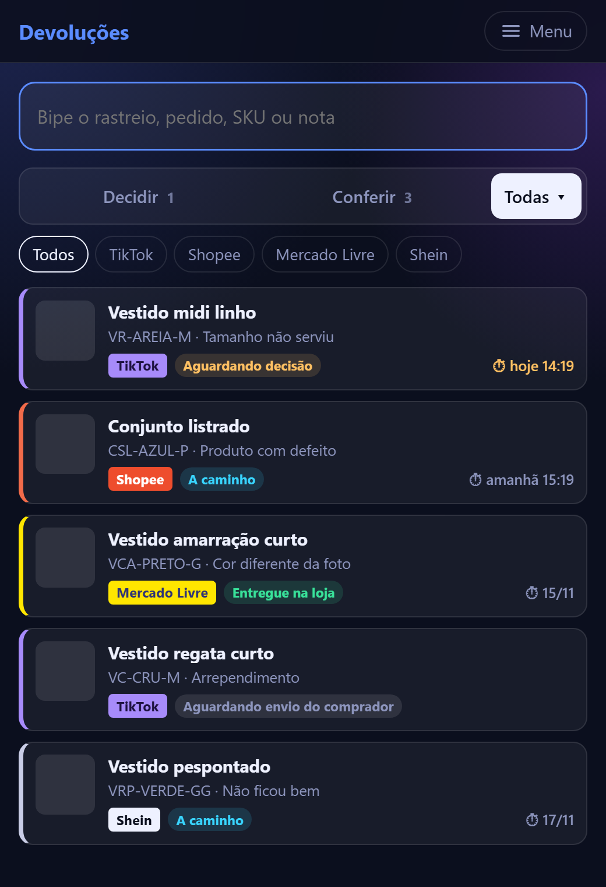
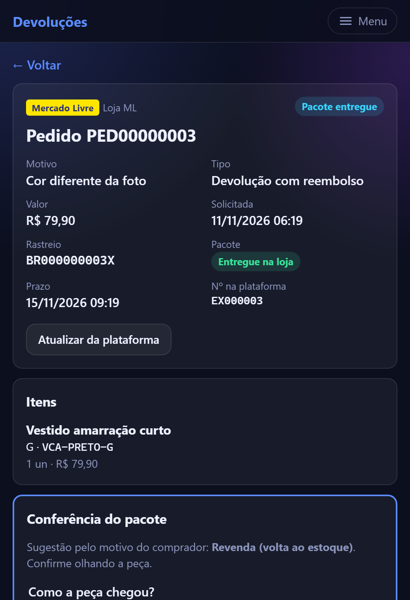
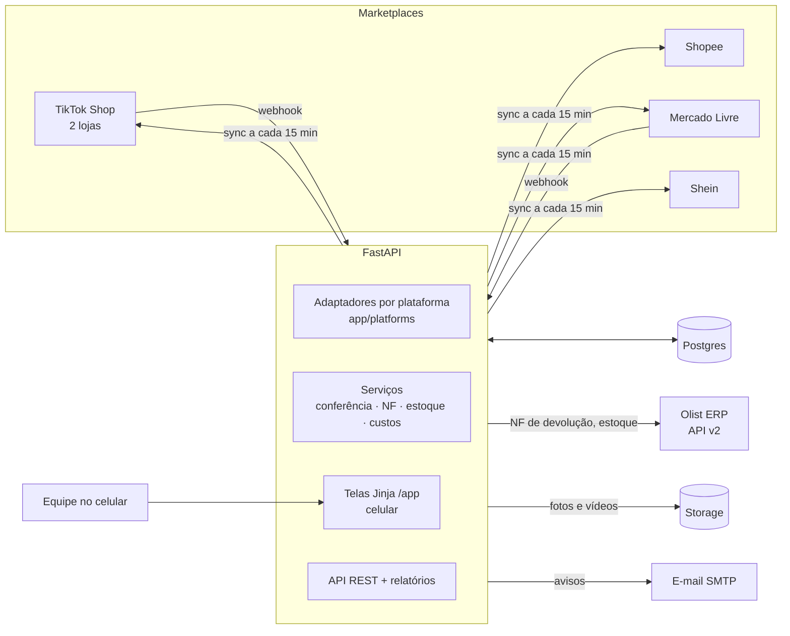

# Central de Devoluções multi-marketplace

Sistema que junta num só lugar as devoluções de uma confecção que vende em **TikTok Shop, Shopee, Mercado Livre e
Shein**. Ele também liga essas devoluções ao **ERP Olist (Tiny)**: emite a nota fiscal de devolução, lança o estoque
no depósito certo e calcula quanto cada devolução custou.

Está em produção numa empresa real, usado todos os dias pela equipe de expedição pelo celular.

> Este repositório é uma cópia de portfólio. Nomes, números de pedido, notas, IDs e valores dos testes e dos
> exemplos são **fictícios**.

<p align="center">
  
  &nbsp;&nbsp;
  
</p>

## O problema

Cada marketplace tem seu painel, suas regras, seus prazos e sua API. Antes, a equipe:

- abria quatro painéis (e duas lojas no TikTok) para descobrir o que tinha chegado e o que vencia hoje;
- conferia a peça na bancada sem registro: sem foto e sem saber quem conferiu;
- fazia à mão, no ERP, a NF de devolução de cada pacote, com risco de errar natureza, CFOP ou valor;
- não sabia quanto as devoluções custavam (frete de volta, peça perdida, taxas que não voltam).

## A solução

- **Uma fila só**, feita para o celular: o operador bipa a etiqueta com a câmera e a devolução abre na hora,
  seja de qual marketplace for.
- **Conferência registrada**: revenda, defeito ou item diferente, com fotos e vídeos. Cada ação fica no histórico,
  com o nome de quem fez.
- **Decisão no marketplace pelo próprio app**: aceitar, recusar ou contestar. As fotos da conferência vão como
  evidência.
- **NF de devolução automática no Olist**: o app acha o pedido e a NF de venda, escolhe a natureza pelo CFOP da
  venda e cria a nota só com os itens devolvidos. Pode criar como rascunho ou já transmitir à SEFAZ.
- **Estoque por depósito**: a peça de revenda volta ao estoque e a com defeito não. Lotes de transferência levam as
  peças entre a matriz e a filial (contas diferentes do Olist).
- **Custo real de cada devolução**, lido do extrato financeiro de cada plataforma: frete de ida e de volta, taxas
  não estornadas e peça perdida (custo por modelo).
- **Avisos por e-mail** (resumo diário e prazo urgente), relatórios, exportação para Excel e uma **API somente
  leitura** para outros sistemas.

## Arquitetura



- **Adaptadores** (`app/platforms/<marketplace>/`): cada marketplace tem um `client` (assinatura, OAuth, limites
  de taxa), um `mapper` (JSON da plataforma → modelo único) e um `adapter` (aprovar, recusar, motivos, evidências).
  O resto do sistema só conhece o modelo normalizado: `pending_review`, `in_transit`, `received`, `completed` etc.
- **Webhooks + sincronização**: os webhooks dão tempo real. A sincronização periódica pega o que se perdeu. Cada
  evento fica gravado em `webhook_events` e é processado sem duplicar, mesmo quando chega ao mesmo tempo que a sync.
- **Histórico completo**: criação, mudança de status, conferência, decisão, NF e erro viram linhas em
  `return_events`.
- **ERP** (`app/erp/olist.py`, `app/services/erp.py`): liga a devolução ao pedido pelo número do marketplace, pelo
  `pack_id` ou pela chave da NF. Monta a nota referenciando a NF de venda e trata o rateio de desconto, as vendas
  apagadas (lendo o XML) e o retorno de mercadoria não entregue.
- **Rotinas** (APScheduler, ou `POST /jobs/run` no Cloud Run): sync, rastreio reverso, conferência das NFs
  autorizadas, extrato financeiro, avisos, backup e checagem de saúde.

## Integrações

| Integração | O que o sistema usa |
|---|---|
| **TikTok Shop** | OAuth de 2 apps, webhook de devolução, aprovar/recusar com fotos, extrato financeiro por pedido |
| **Shopee** | Assinatura HMAC, devoluções paginadas por janela, contestação com evidências, rastreio reverso, repasse (escrow) |
| **Mercado Livre** | Reclamações e devoluções (post-purchase v1/v2), revisão do pacote, mediação, faturamento, webhook |
| **Shein** | Autorização com segredo cifrado (AES), devoluções, assinatura do recebimento, liquidação |
| **Olist ERP (Tiny API v2)** | Pedidos, NF de venda, NF de entrada de devolução, emissão, estoque por depósito, transferência entre contas |
| **Google Cloud Storage / Supabase Storage** | Fotos e vídeos da conferência (vídeo recomprimido com ffmpeg) |
| **SMTP** | Resumo diário, alerta de prazo e falhas de integração |

## Stack

- **Python 3.12**, **FastAPI**, **SQLAlchemy 2** e **Pydantic v2**
- **PostgreSQL** (Supabase), com 28 migrações SQL em `supabase/migrations/`
- **Jinja2** nas telas, com CSS e JS puros, sem etapa de build e pensadas para o celular (leitura de código de barras pela câmera)
- **httpx** nos clientes das APIs, **APScheduler** nas rotinas, **cryptography** (Fernet) para guardar os tokens
  cifrados e **openpyxl** para os relatórios em Excel
- **pytest**: 300 testes, sem banco nem rede (os clientes HTTP são simulados)
- Deploy: Docker/Cloud Run, ou um PC Windows com Tailscale Funnel (scripts em `deploy/`)

## Segurança

- Tokens das lojas cifrados no banco (Fernet). Segredos só no `.env`, nunca no código.
- Login individual com senha forte, sessão assinada, bloqueio após tentativas erradas e opção de "sair de todos os
  aparelhos". Perfis `operador` e `gestor`.
- Chaves de integração somente leitura (`pdv_...`), guardadas com hash e revogáveis.
- Webhook do TikTok validado por assinatura HMAC. O do Mercado Livre só serve de aviso: os dados são sempre
  relidos na API oficial.

## Como rodar

Pré-requisitos: Python 3.12 e um Postgres (local ou Supabase).

```bash
git clone https://github.com/GeovannySantana-dev/devolucoes-api.git
cd devolucoes-api
python -m venv .venv
.venv/Scripts/pip install -r requirements.txt      # Linux/macOS: .venv/bin/pip
cp .env.example .env                               # preencha DATABASE_URL e API_KEY
```

Rode, em ordem, os arquivos de `supabase/migrations/` no banco. Depois:

```bash
.venv/Scripts/python scripts/criar_usuario.py voce@exemplo.com "Seu Nome" gestor
.venv/Scripts/uvicorn app.main:app --reload
```

- Telas: http://localhost:8000/app
- Documentação interativa da API: http://localhost:8000/docs

As credenciais dos marketplaces e do Olist são opcionais: sem elas, as integrações ficam desligadas.

### Testes

```bash
.venv/Scripts/python -m pytest -q
```

Os testes não precisam de banco nem de internet.

## Estrutura

```
app/
  platforms/      adaptadores: tiktok, shopee, mercadolivre, shein
  erp/            cliente do Olist e leitura de XML de NF-e
  services/       regras de negócio: conferência, NF, estoque, custos, avisos, lotes, mídia
  routers/        API REST, webhooks, OAuth, relatórios, API de integração
  ui/, templates/ telas da equipe (Jinja)
supabase/migrations/  esquema do banco
scripts/          autorizar lojas, sincronizar, rotinas, câmera da bancada
deploy/           Cloud Run e servidor Windows
tests/            300 testes
```

## Documentação

- [Guia técnico](docs/guia-tecnico.md): regras de cada marketplace, fluxo da NF, custos e endpoints
- [API de integração](docs/api-integracao.md): API somente leitura para outros sistemas

## Licença e autoria

Copyright (c) 2026 Geovanny Santana Bonfim. Licenciado sob a
[PolyForm Noncommercial 1.0.0](LICENSE): o código pode ser visto, estudado e usado para fins não comerciais,
mas **qualquer uso comercial — vender, revender, sublicenciar, oferecer como serviço ou operar com fins
lucrativos — exige autorização por escrito do autor**. Ver [AUTHORS](AUTHORS).

## Autor

[@GeovannySantana-dev](https://github.com/GeovannySantana-dev)
